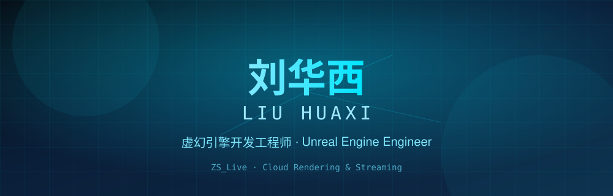

<!-- ===== Liu Huaxi · Bilingual Gold-Tech Profile ===== -->

  

  

  
  
  
  
  

## 🧑‍💻 关于我 · About Me

> 我是**刘华西**，一名**虚幻引擎（Unreal Engine）开发工程师**。曾参与**国家水利、国家电网、智慧城市、智慧地产、智慧水务**等多个大型政企项目，在实时三维可视化、数字孪生与流媒体方向积累了丰富经验。我独立研发了自托管云游戏 / 实时推流产品 **ZS_Live**。

> I'm **Liu Huaxi**, an **Unreal Engine development engineer**. I've contributed to large-scale government & enterprise projects — **National Water Conservancy, State Grid, Smart City, Smart Real Estate, and Smart Water** — with deep experience in real-time 3D visualization, digital twins, and streaming media. I independently built **ZS_Live**, a self-hosted cloud-gaming / real-time streaming product.

  
  

## 🛠️ 技术栈 · Tech Stack

  
  
  
  
  
  
  
  
  
  
  

## 🏗️ 项目经历 · Project Experience

| 🌊 领域 Domain | 🎯 代表方向 Focus | 🔑 关键词 Keywords |
| :--- | :--- | :--- |
| **国家水利** National Water | 水利数字孪生 · 三维可视化 | Digital Twin · 3D Viz |
| **国家电网** State Grid | 电网态势感知 · 巡检可视化 | Grid Ops · Inspection |
| **智慧城市** Smart City | 城市级 CIM · 数字孪生 | CIM · Digital City |
| **智慧地产** Smart Real Estate | 三维营销 · 楼盘可视化 | 3D Marketing |
| **智慧水务** Smart Water | 监测管网 · 调度可视化 | Monitoring · SCADA |

## 🚀 旗舰产品 · Flagship — ZS_Live

  
  
  

**ZS_Live** — 自研自托管云游戏 / 实时推流平台 ｜ *Self-hosted cloud-gaming & real-time streaming platform.*

- 🎮 **GPU 实例编排** — NVENC 硬件编码 + GPU 权重准入（单张 RTX 4090 可达 6× 4K@30）
- 📡 **实时推流** — 基于 MediaMTX 的 RTSP / WebRTC 采集与播放，亚秒级延迟
- 🔐 **授权系统** — RSA 签名令牌，按实例数 / 有效期分级（试用 / 应用授权 / 源码）
- 🖥 **跨平台管理** — 响应式 Web 控制台 + 原生 WinForms 签发工具
- 🧩 **UE 集成** — 自研虚幻引擎插件，引擎内采集与控制通道
- 🎮 **GPU Instance Orchestration** — NVENC HW encode + GPU-weight admission (up to 6× 4K@30 on one RTX 4090)
- 📡 **Real-time Streaming** — RTSP / WebRTC ingest & playback via MediaMTX, sub-second latency
- 🔐 **License System** — RSA-signed tokens gating instance count & expiry (trial / app / source)
- 🖥 **Cross-platform Admin** — reactive web console + native WinForms signing tool
- 🧩 **UE Integration** — custom Unreal Engine plugin for in-engine capture & control

  

## 🌟 愿望 · Wishes

| 🛋️ 躺平自由 | ☮️ 世界和平 | 😊 每天开心快乐 |
| :---: | :---: | :---: |
| **不为钱而挣扎** <i>No struggle for money</i> | **天下太平** <i>A peaceful world</i> | **天天好心情** <i>Happiness every day</i> |

  
  
  

## 📊 数据与活跃度 · Stats & Activity

  

  

  

## 📡 联系方式 · Connect

  
  <!-- 在此补充邮箱 / 微信 / 网站 | add email / wechat / site here -->

---

  
   
  

